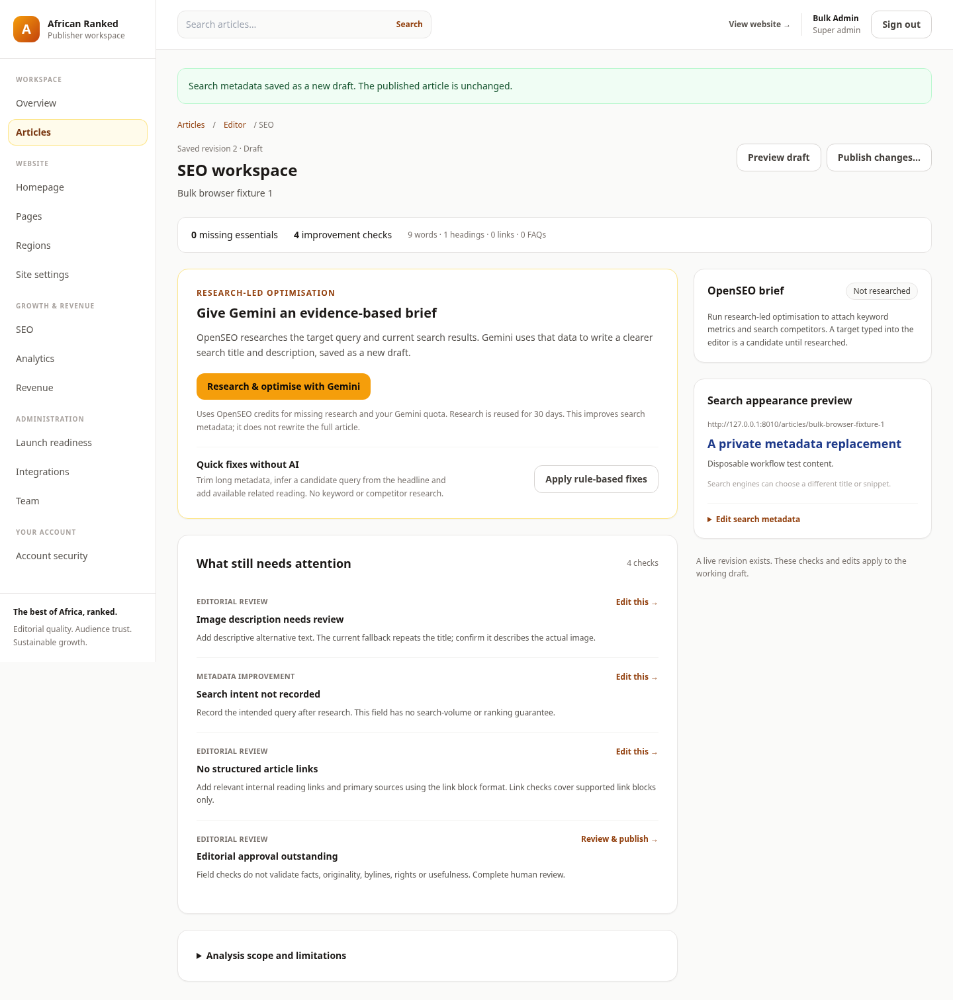
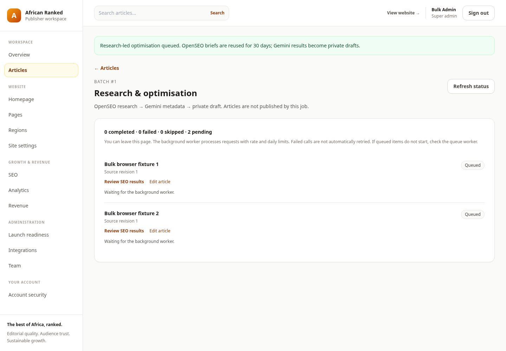
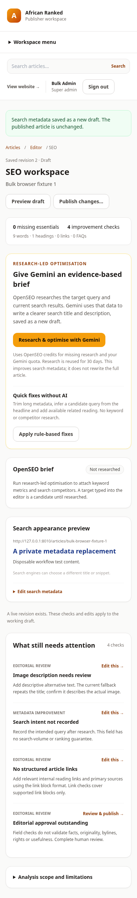

# SEO production workflow review

The owner's supplied screenshot showed two similar optimisation buttons, a generic Gemini error without an actionable recovery path, and a large audit list disconnected from editing/publishing. The implementation keeps the existing amber/stone design and changes the workflow around those observed problems. This is an implementation review with local Chromium evidence, not a full accessibility or competitor-design audit; the Product Design plugin's managed browser was unavailable.

1. **Choose the action — verified.** The SEO workspace distinguishes research-led optimisation from rule-based fixes. The primary action explains that OpenSEO supplies the brief and Gemini writes metadata; the secondary action says no keyword/competitor research is performed. Search preview and direct metadata editing sit beside the findings. Each finding has a descriptive accessible edit link, while publication stays a separate action.

   

2. **Confirm and follow the batch — verified locally.** Selecting articles provides a count, bulk publishing requires explicit editorial approval of the selected saved revisions, and stale/unauthorised batches are rejected. Research/optimisation has a quota and provider-credit confirmation, durable background processing, per-item results and automatic status refresh. The screenshot intentionally shows queued fixture jobs; no test key was used for a live API call. Actual provider research and the live Gemini probe are documented separately.

   

3. **Use the flow on mobile — verified at 390px.** Actions wrap, navigation collapses, the research/metadata cards appear before the detailed findings, and document width stays within the viewport. The expanded desktop sidebar now scrolls so lower administration links remain reachable on short screens.

   

Backend verification: 91 tests / 3,316 assertions passed on SQLite and PostgreSQL. Full browser verification: 15 tests passed, followed by a focused pass after refining the mobile ordering. The flows include bulk publication, queued research confirmation/progress, metadata edits preserving the published article, desktop/mobile rendering, author ownership and MFA. The actual Railway instance still needs the acceptance checks in [the deployment runbook](RAILWAY-DEPLOYMENT.md).

Limits: no full screen-reader audit, external factual verification, Core Web Vitals field data or Google ranking outcome is established by these checks. The screenshots use disposable test identities/content, not live account credentials. Research-led metadata optimisation does not expand the full article body.
